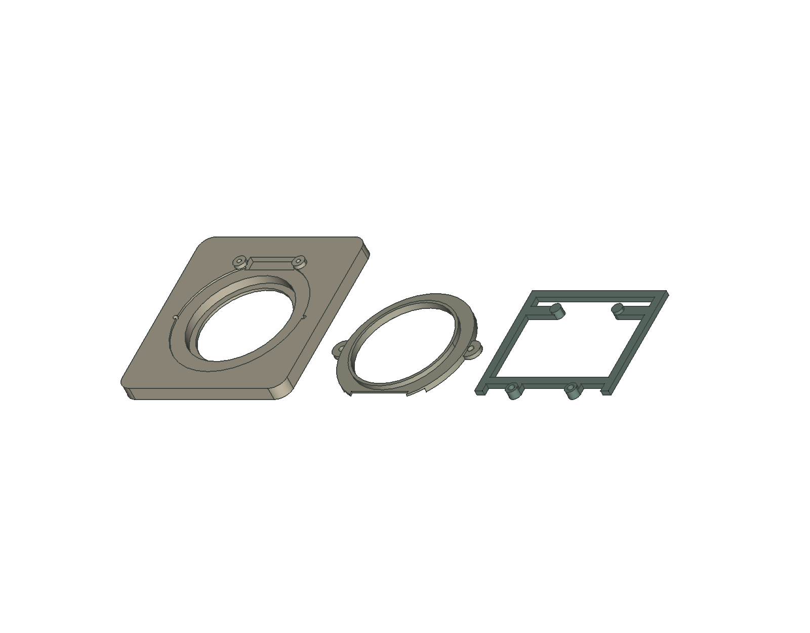
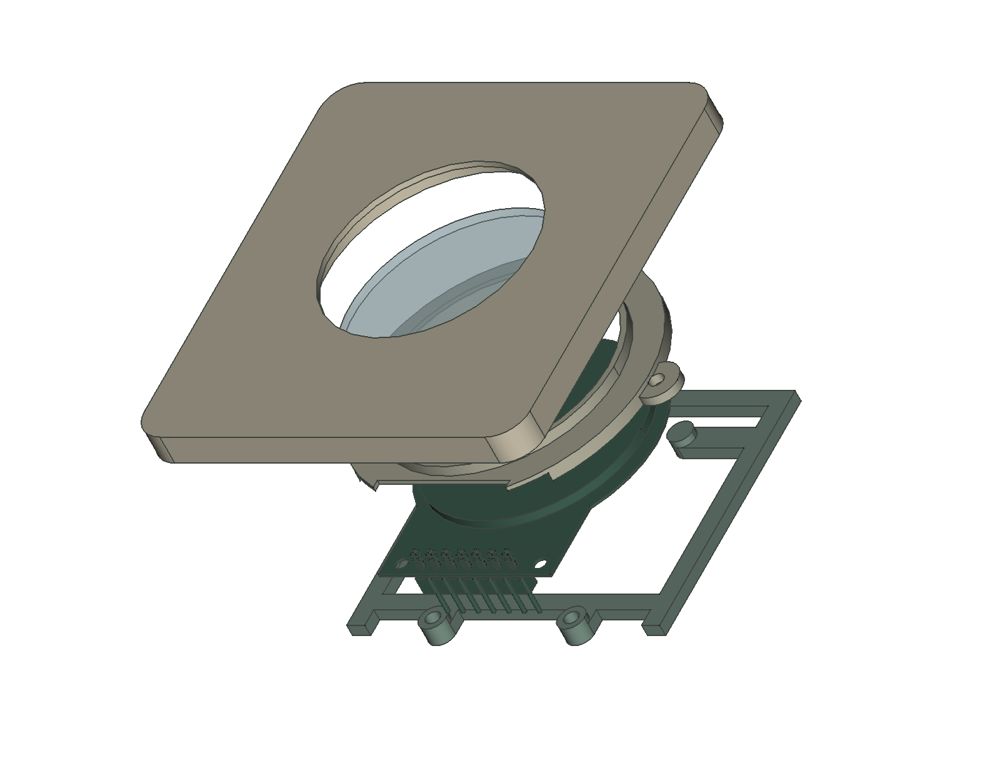
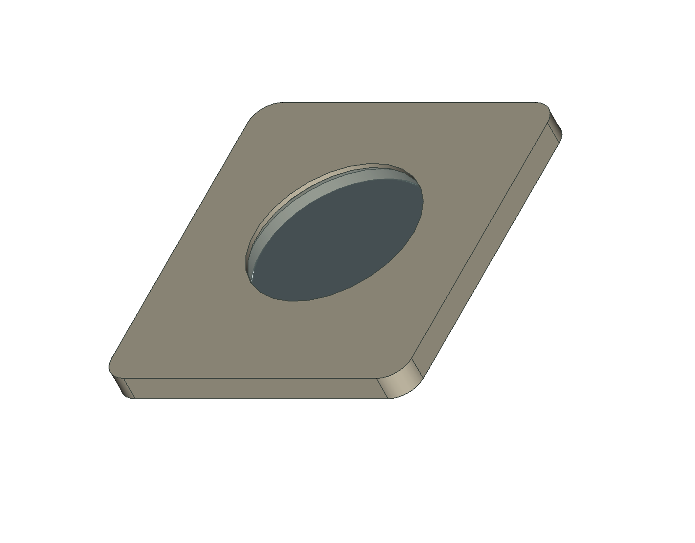
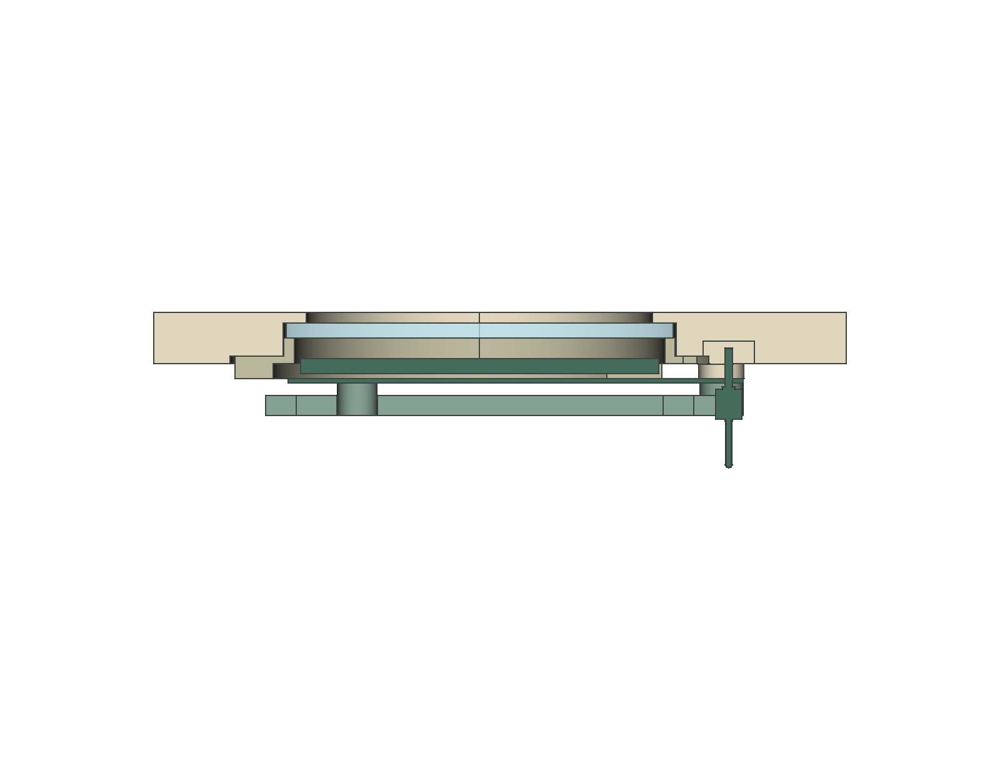

# Adult-only LCD fit-test assembly and checklist

**Historical assembly guide.** Hold the original STL set pending the
[1.60 mm PCB dimensional review](../enclosure/freecad/LCD-PCB160-review.md).
Its revised cradle and provisional M1.6 fasteners have not been exported or
physically tested. Instructions below describe the earlier preserved print set.

This is an engineering fit test, not a child-safe toy. Keep the disconnected
LCD, screws, lens and tools under adult control. Start **unpowered**. Disconnect
USB and every other supply before handling electronics; this guide does not
authorize battery wiring or simultaneous power sources.

Print one set of [these three STLs](../enclosure/prints/lcd-fit-test/README.md).
Use the [dimensioned drawing](../enclosure/freecad/LCD-fit-test-dimensions.svg)
and [mechanical review](../enclosure/freecad/LCD-mechanical-review.md), not a
scaled screenshot, for dimensions. The user reports the boards match the working
model, but individual physical dimensions and safe clamp loads remain unmeasured.

## 1. Identify and prepare the printed parts

Left to right: panel coupon, stepped lens retainer, rear cradle. The clear lens,
LCD and four screws are purchased parts. The picture is a layout reference;
each supplied STL has its own local origin and correct bed orientation.

Cool the prints, remove brim/support/stringing and inspect for missing walls,
rough bearing surfaces, cracks, warp and blocked bores. Do not scrape the lens
or PCB to make a bad print fit. Record actual dimensions and any rework. Trial
the ring in the empty panel and check pilots with spare plastic/actual screws
before bringing the LCD near them. No motorized driver or forced fit.

## 2. Capture the lens first

Rest the panel front-down on a clean, non-abrasive surface. From the rear, place
the measured **38 x 1.5 mm provisional polycarbonate disk** into its pocket so
its outer edge is concealed behind the front lip. Remove stock protective film
as appropriate and keep particles out of the optical stack. It must sit flat
without force; do not use adhesive against the display.

Fit the stepped retainer with its **narrow nose toward the lens/pocket** and
its neck notch toward the future pin header. Align the two side-tab holes and
fit the two provisional M2 x 4 screws by hand. Check the actual screw type,
head and under-head length first. Seat the ring without stripping pilots or
preloading/bowing the lens. If zero-play CAD dimensions cause compression,
stop and revise the stack rather than adding torque. Do not install the LCD
until the lens is independently retained.

## 3. Place the LCD without stressing it

Hold the LCD by PCB edges. Turn its display toward the lens and its seven-pin
neck toward the matching relief/notch. Lower it into place without touching
the active glass. Its two existing holes must drop freely over the mounting
axes; the board's front-side lands rest on the two standoffs. Do not push on
the glass, bow the PCB, drill the PCB, or use screws to drag holes into alignment.

Verify rear components and solder are clear of all four proposed cradle contact
lands before fitting the cradle. The two upper pads are intended to support the
PCB backside, not press on electronics. If a trace/component/solder joint lies
under a pad, stop and change the support geometry or insulation design after
review. The STEP lacks these real rear details.

## 4. Install the cradle and rear fasteners

Place the cradle with its **raised pads toward the PCB**. Keep its header opening
clear. Insert the two provisional M2 x 8 PCB/cradle screws through the cradle and
existing PCB holes into the panel's blind pilots. Start both by hand and bring
them into contact alternately while supporting the LCD. No tightening torque is
qualified: stop at resistance, distortion, scraping, cracking or stripping.
No screw may emerge on the front. Do not add washers/change lengths without
rechecking the stack and the narrow 0.3 mm head-bearing margin.

Lens-ring screws are obstructed by the installed cradle; this is why the lens
is assembled first. Screw envelopes shown in CAD do not simulate real threads
or establish retention strength. A hand-fit assembly is not an impact test.

## 5. Inspect the optical, PCB and wiring clearances

The target air gap is **2 mm** between LCD front and lens rear. Verify a positive
gap without inserting a tool against the active display. Check side light/view,
measured component stack and non-contact inspection; any loaded/deformed gap
requires a separate controlled test. The nominal 0.6 mm body/ring clearance,
0.65 mm header/panel clearance and 0.41 mm header/cradle clearance are small.

Check the actual mating connector, solder and wires, including removal and bend
space. No lead should be pinched, rubbed on a cut edge or held by its solder
joint. Do not treat the modeled 6 mm rear reserve as verified wiring clearance.
Inspect the full active circle and labels at normal and oblique angles.

Only after the unpowered fit passes may an adult reconnect the **existing verified
USB bench setup** for a functional display check. Follow [verified wiring](../hardware/wiring.md),
disconnect before changes, and preserve the firmware/GPIO map. No new battery
supply hookup is part of this test. Check both displays with the working board
as applicable and record flicker, clipping, resets or strained wiring.

## 6. Service and disassemble

Disconnect every power source. Support the LCD, unplug its leads by their
connectors, and remove the two cradle screws. Lift the cradle, then withdraw
the LCD rearward. The lens should remain independently captured. For lens
service only, remove the two ring screws, lift the ring and withdraw the lens
inward. Account for all loose screws/parts and inspect worn pilots before
reassembly. Retest both alignment and clearance after servicing.

## Physical fit-test checklist

Record date, board revision/sample, printer/material/profile, lens dimensions,
screw type/head/under-head lengths, photos and readings. Mark **not tested**
rather than assuming a pass. Use both Dorhea boards individually.

- [ ] Three prints are complete, flat, crack-free, deburred and match the recorded slicer dimensions.
- [ ] Actual PCB hole diameters, 23 mm model pitch and LCD-center offsets checked; no forced alignment.
- [ ] Actual PCB thickness, glass/bezel/FPC stack and all four contact lands checked against the source.
- [ ] Lens diameter/thickness measured; disk sits flat with its outer edge concealed.
- [ ] Ring fits freely before fastening; lens is retained independently without preload/bowing.
- [ ] Actual screw types/lengths/heads fit; pilots do not split/strip or bottom out.
- [ ] Cradle supports the PCB without bowing, rocking or contacting rear components/solder.
- [ ] Screws have adequate observed engagement and do not protrude through the front; narrow head-bearing areas remain intact.
- [ ] Positive display/lens gap verified and recorded; glass has no contact marks or visible distortion.
- [ ] Full display is visible normally and obliquely; no unexpected pixel/label clipping.
- [ ] Header, plug, solder and wires clear the panel/cradle, with usable insertion/removal and bend space.
- [ ] LCD can be replaced without removing the lens; all fasteners reachable in the documented order.
- [ ] Adult-only functional check on existing verified bench supply passes, or is explicitly marked not tested.
- [ ] Gentle handling/service observations recorded; repeat-service, strength and impact qualification remain separate.
- [ ] All loose parts accounted for and prototype stored out of child access after testing.

| Observation | CAD / provisional target | Physical reading, result or action |
| --- | --- | --- |
| PCB thickness | Source 0.41148 mm; unconfirmed physically | |
| Mount holes / pitch | Source diameter 2.10 / pitch 23 mm | |
| Lens stock | Proposed diameter 38 x 1.5 mm | |
| Display-to-lens gap | Proposed 2 mm, unloaded | |
| Header/panel and header/cradle gaps | CAD about 0.65 / 0.41 mm | |
| Fasteners and engagement | Proposed M2 x 8 and M2 x 4; verify type/length | |
| First fit / rework / repeated service | No observed result yet | |

Passing this checklist documents a limited engineering fit test. It does not
qualify mechanical retention, impact resistance, materials, electrical safety
or accessibility of small components for child handling.
