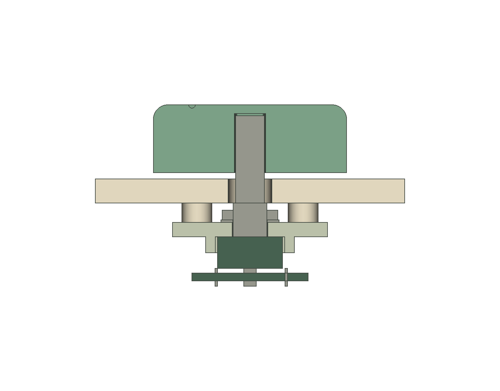

# Encoder and removable-knob calibration fixture

Adult-only engineering test for **Bourns PEC11R-4225F-S0024**. This package uses
the manufacturer's nominal dimensions, not measurements of the owned encoders.
It does not establish strength, pull-off resistance or suitability for children.
Existing LCD print packages are unrelated and unchanged.

Print one panel, one bulkhead and either knob. Both knob variants are supplied
for comparing the tactile interface. Import STLs in **mm at 100% scale**.
They contain only printed geometry, with minimum Z=0.

| File | Purpose | Nominal bounding dimensions, mm | Orientation |
| --- | --- | --- | --- |
| [encoder-test-panel.stl](encoder-test-panel.stl) | 5 mm faceplate with 4 mm rear posts | 64 × 64 × 9 | Front face on bed; posts up |
| [encoder-rear-bulkhead.stl](encoder-rear-bulkhead.stl) | 3 mm mounting plate and anti-rotation pocket | 36 × 32 × 6.3 | Flat front/nut side on bed; body pocket up |
| [balance-knob.stl](balance-knob.stl) | 40 mm rounded knob, one tactile groove | 40 × 40 × 14 | Flat shaft-entry underside on bed; tactile surface up |
| [phase-knob.stl](phase-knob.stl) | Same envelope, two tactile grooves | 40 × 40 × 14 | Same as Balance |

[validation.json](validation.json) records actual mesh bounds, volumes, hashes
and written-STL topology checks. Sources:
[encoder fixture](../../freecad/MyFirstQubit_encoder_knob_fixture.FCStd),
[Phase knob in full assembly](../../freecad/MyFirstQubit_iteration03_controls_prototype.FCStd).
See the [engineering review](../../freecad/controls-mechanical-review.md)
for datums, manufacturer evidence, loads and button-release blockers.

## Starting print settings and inspection

Suggested initial room-temperature dimensional trial: plain unfilled PLA,
0.4 mm nozzle, 0.15 mm layers (0.20 first), 4 requested perimeters, 6 top/bottom
layers. Use 30% panel infill and 100% bulkhead/knob infill. Follow the actual
printer/filament temperature and cooling profile. No slicer or physical print
has been qualified. Do not globally scale meshes to make the shaft fit.

The panel and pocket-up bulkhead should normally need no supports. The knob
contains a blind 6.4 mm socket roof, rear-open captive-nut slot and transverse
3.4 mm screw-access port: inspect bridging and the approximately 1.8 mm roof
in the slicer. Try the printer's validated small-bridge settings; if internal
supports are needed they must be completely removable without changing the
shaft bore/flat or nut bearing faces. Reject sag, fused bores, missing nut-trap
walls, layer separation or cracks. Upper edge fillets face upward and retreat
inward. The shallow tactile grooves must remain distinct.

The socket's provisional 0.2 mm nominal radial allowance and flat clearance
can be consumed by printing errors. M7 bushing opening is 7.4 mm nominal.
Measure prints; do not drill a shaft, force the case or substitute larger
screws. Report material/profile and before/after dimensions for any rework.

## Hardware to identify and measure

- One existing PEC11R-4225F-S0024 encoder, its actual **M7 × 0.75 nut and washer**.
  This is the flatted, 25 mm shaft, rear-facing pin variant; confirm markings.
- Candidate M3 × 16 recessed grub screw, hex key, and M3 hex nut nominally
  5.5 mm across flats × 2.4 mm thick. The trap is provisional: measure the
  purchased hardware and test it in spare plastic before bringing in the encoder.
- Four candidate M2.5 × 8 bulkhead screws. 2.8 mm clearance bores and 2 mm
  printed pilots are **not** a selected screw/pilot pairing. Verify thread type,
  engagement and insertion depth on a second panel, with no electronics.
- Calipers and a suitable hand driver. No powered driver, adhesive or new wiring
  is required for an unpowered mechanical fit. An electrical PCB is not included;
  its envelope is provisional and the 5 rotation/push terminals are not all used.

The bulkhead's 3 mm plate + nominal 0.5 mm washer + 2 mm nut leaves 1.5 mm
of the 7 mm bushing. Actual nut/washer tolerances, printed flatness and torque
must be checked. Do not apply a manufacturer's metal-panel torque limit to PLA.
Electrical terminals and solder joints must not support knob loads. Keep the
push terminals and mounting tabs electrically unconnected as in the verified
wiring. Any connection-board assembly process requires separate review.

## Assembly and first-fit checklist

1. Disconnect all power. Inspect prints, clear debris and measure encoder body,
   shaft diameter/flat/length, bushing, washer/nut and chosen knob hardware.
2. Test mounting screws in spare plastic to the intended 5 mm engagement. Do
   not run the entire screw into an empty blind pilot or use the encoder as
   a thread-forming fixture. Stop at splitting, binding, stripping or bottoming.
3. Insert the encoder from behind the bulkhead. Its body should seat on the
   mounting face without case compression; tabs/pins remain free. Fit washer
   then nut on the other side. Seat gently by hand with the appropriate tool.
4. Fasten the bulkhead onto the four panel posts from behind. Ensure nut and
   shaft pass freely below/through the faceplate and no hardware is exposed
   on the primary front face.
5. Slide the measured M3 nut into the knob's rear-open trap. Fit the knob to
   the shaft with **1.3 mm nominal face clearance**, then use the recessed grub
   screw on the flat. Do not force the socket or bottom the shaft against its
   roof. No tightening torque or reliable pull-off load has been established.
6. Check full rotation, tactile grip, axial movement and removal. The encoder
   push function remains mechanically present but electrically unused. Its
   maximum specified travel leaves only 0.5 mm nominal face clearance before
   tolerances. Stop if the knob rubs or the shaft/case is stressed.
7. For service, loosen/remove knob under adult control, remove rear mounting
   screws, withdraw bulkhead, then remove its nut. Account for loose hardware.

Record board/encoder identity, actual dimensions, print/profile, screw/nut
specifications, photos and results. Test both intended encoders independently.

- [ ] Body and bushing seat without force; no load reaches electrical pins.
- [ ] Real nut/washer engagement and bulkhead seating verified without crushing PLA.
- [ ] Pilot test passed with the chosen real screws; no cracks/stripping/bottoming.
- [ ] Shaft slides into the D socket without force and remains clear of the blind roof.
- [ ] Captive nut seats; screw tip bears on the shaft flat and remains recessed.
- [ ] Full rotation and push movement clear the faceplate; one/two grooves are distinguishable.
- [ ] No observed slip or loose hardware in a gentle adult trial; loads and observations recorded.
- [ ] Removal/reinstallation works; wear, wobble and any loss of fit recorded.

A limited fit pass requires every applicable item above, with no forced fit,
damaged plastic or stressed encoder. It does **not** qualify screw loosening,
shaft/knob pull-off, repetitive operation, impact, materials or child safety.
Stop and revise a new CAD version for any failing fit; preserve these sources.

## Button fixtures remain CAD-only

The [gate](../../freecad/MyFirstQubit_gate_button_fixture_PROVISIONAL.FCStd)
and [Measure](../../freecad/MyFirstQubit_measure_button_fixture_PROVISIONAL.FCStd)
fixtures demonstrate captive caps, guides, stops and supported PCB carriers.
No button STLs are released: actual switch height, actuator travel/force,
terminal footprint, PCB outline/contact lands and suitable clip fasteners must
be measured first. Their assumed stack must not be used to clamp or overtravel
the existing switches. See the engineering review for the measurement gate.
