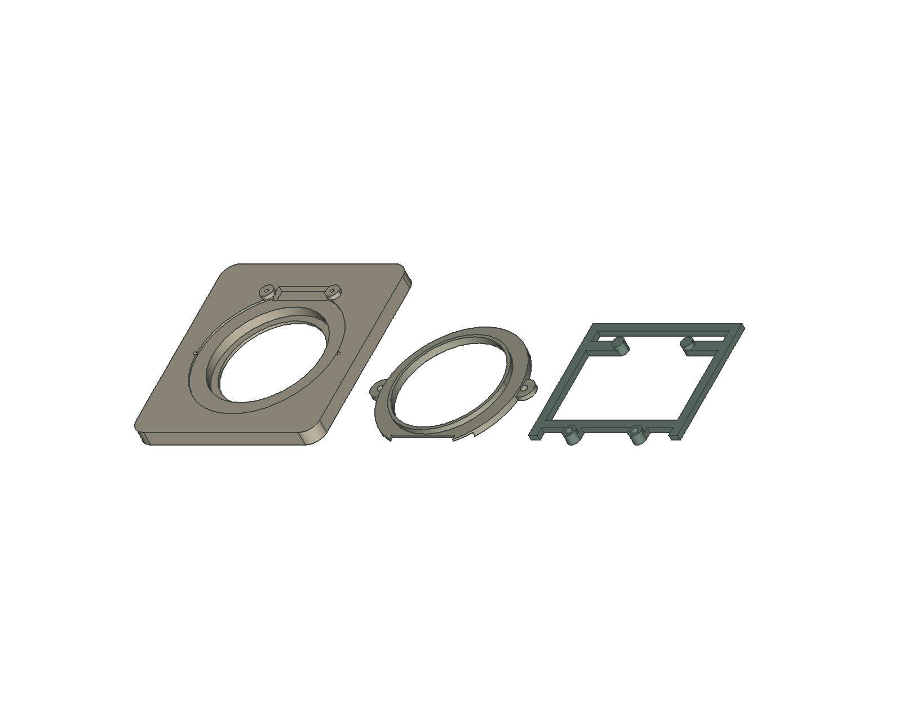
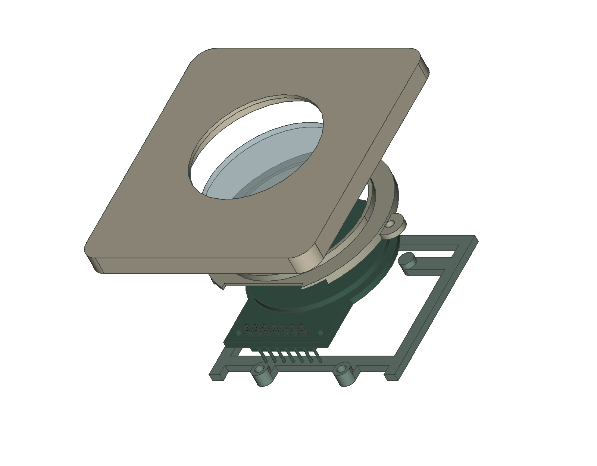
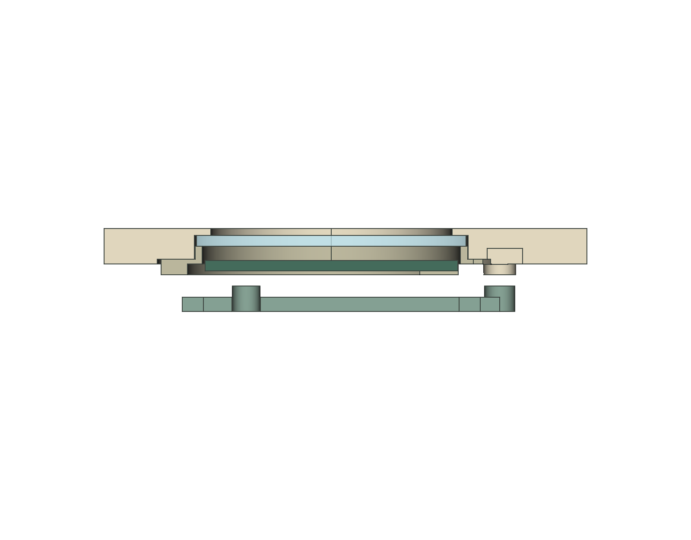

# PCB160 LCD fit-test print package — adult engineering trial

Print this small three-part fixture to test one existing Dorhea seven-pin
GC9A01 LCD at a time. Test both physical boards individually. It reproduces the
revised mounting stack, removable rear cradle and captured protective lens;
it is not the full enclosure, a production release or a child-safe assembly.

**Ready for an adult-operated initial print, inspection and unpowered fit trial.**
Fastened assembly is conditional on the measurements and sacrificial pilot test
below. No physical print, slicer profile, tightening torque, thread strength,
retention, impact or material-safety test has been performed by this export.

## Files and source of truth

Print one of each file. They contain only their named native printed solid,
with source CAD bounds placed at local XY minimum zero and bed Z=0 (curved
mesh XY extrema can differ by less than 0.001 mm). STL has no encoded unit:
import as **millimeters, 100% scale**, with automatic orientation/scaling off.

| File / purpose | Exported X × Y × Z, mm | Bed orientation |
| --- | --- | --- |
| [lcd-fit-panel-pcb160.stl](lcd-fit-panel-pcb160.stl): 64 × 68 mm front coupon, optical pocket, posts and pilots | 64.0000 × 68.0000 × 6.5000 | Smooth exterior/front face down; rear pockets and posts up |
| [lcd-lens-retainer-pcb160.stl](lcd-lens-retainer-pcb160.stl): removable stepped ring that captures lens from inside | 56.9992 × 45.3307 × 4.0000 | Flat flange rear face down; narrow lens-bearing nose up |
| [lcd-rear-cradle-pcb160.stl](lcd-rear-cradle-pcb160.stl): replaceable PCB backside support | 52.0000 × 46.9260 × 3.6000 | Flat rail backs down; four raised contact pads up |

The panel plate itself is 5 mm thick; integral posts add approximately 1.5 mm.
These exports came directly from `DimensionedFitCoupon`, `TestLensRetainer`
and `TestLCDCradle` in the saved
[PCB160 native fit test](../../freecad/MyFirstQubit_LCD_fit_test_PCB160.FCStd),
revision `51333cab9216e78d407e691b62e676a4a1f89a4c`.
The corresponding [enclosure assembly](../../freecad/MyFirstQubit_iteration03_LCD_PCB160.FCStd),
[dimensional comparison](../../freecad/LCD-PCB160-review.md) and
[dimensioned axial section](../../freecad/LCD-PCB160-section-dimensions.svg)
explain the engineering assumptions.

The [original print package](../lcd-fit-test/README.md) is preserved as history.
Do not mix its panel/cradle or M2 assumptions with this revised set. The retainer
geometry is unchanged and its new STL happens to have the identical SHA256;
it is nevertheless included under a distinct name for a complete PCB160 set.
No lens, LCD, header, electronics, fastener, wiring envelope or whole enclosure
is included as printable geometry. No native CAD geometry or critical clearance
was changed to prepare these files.

## Initial PLA printing setup

Use ordinary unfilled PLA for the initial room-temperature dimensional trial,
on a calibrated FDM printer. The following are **proposed starting settings**,
not a tested profile or a material qualification. Follow your printer/filament
manufacturer's temperature, cooling and speed profile. PLA's ease of printing
does not establish impact or heat performance; see
[Prusa's PLA guidance](https://help.prusa3d.com/article/pla_2062).

| Setting | Initial recommendation |
| --- | --- |
| Nozzle | 0.4 mm |
| Layers | 0.15 mm; first layer 0.20 mm |
| Perimeters | 4 requested; inspect actual toolpaths in thin regions |
| Top/bottom | 6 solid layers each |
| Infill | Panel 30%; retainer and cradle 100% |
| Raft | Off |
| Brim | Only if needed for adhesion; remove without damaging thin edges |
| Orientation | Keep supplied orientation; slice separately or space parts with machine margins |
| Compensation | Calibrate extrusion/first layer; no global STL scaling or undocumented hole compensation |

A 1 mm wall cannot contain four ordinary 0.4 mm perimeter lines. Confirm the
slicer preserves it with appropriate thin-wall/variable-width paths rather
than silently removing it. [Prusa's layer/perimeter documentation](https://help.prusa3d.com/article/layers-and-perimeters_1748)
describes these slicing considerations. Inspect every layer before printing;
these meshes have not been machine-specifically sliced here.

## Overhangs, supports and vulnerable features

The native screenshot is an orientation reference, not slicer/G-code evidence.
Each STL is exported separately from the solid and has its own origin.

- **Panel:** supports normally unnecessary front-down. Check the shallow
  pockets, optical lip, 1.2 mm blind pilots, 1.5 mm posts and their junctions.
  Do not pack supports into blind pilots or the optical opening. Avoid damaging
  the front finish or optical edge during removal from the bed.
- **Retainer:** the flange-to-shoulder transition projects inward about **2.1 mm
  radially**, forming an unsupported ledge. Use localized removable support
  beneath that ledge unless a separate bridge trial proves the selected profile
  can make it cleanly. A support-free attempt is an experiment. Inspect support
  access/removal in the slicer; protect the upper lens-bearing surface and
  screw bores. Reject droop or a shoulder damaged by support removal.
- **Retainer vulnerabilities:** approximately **1 mm nose wall**, **0.7 mm
  shoulder**, **1.5 mm flange/tabs** and the header notch. Handle without bending
  or squeezing; four requested perimeters do not guarantee these features print.
- **Cradle:** supports normally unnecessary flat-back-down. Its rails/base are
  2 mm thick; pads rise 1.6 mm. Inspect narrow arm/pad joins and the 2.4 mm
  clearance bores. Around neck pads, the 4.4 mm outer diameter leaves a nominal
  1 mm radial wall to the bore. Layer adhesion and screw loads remain untested.

Reject disconnected islands, missing thin-wall paths, slicer repair warnings,
warping, delamination or rough bearing faces. Do not alter a critical clearance
to hide a slicing problem. Record printer/material errors and any deliberate
rework; revise named native parameters in a new controlled version if needed.

## Hardware and provisional mechanical stack

| Needed for one fit-test fixture | Quantity / specification | Status |
| --- | --- | --- |
| Existing Dorhea GC9A01 seven-pin LCD | One at a time; repeat with both boards | Exact physical dimensions still unverified |
| Clear polycarbonate lens | One disk, **38 mm diameter × 1.5 mm thick** | Provisional; measure stock, cut diameter, flatness and edge finish; not printed |
| PCB/cradle screws | Two, **M1.6 × 8 mm candidate**, under-head length | Thread type/part number/pilot compatibility not selected |
| Lens-ring screws | Two, **M1.6 × 4 mm candidate**, under-head length | Same qualification required |
| Head envelope | Diameter **3.2 mm**, height **1.3 mm** | CAD assumption; actual head/drive must be checked |
| Measuring/assembly tools | Calipers, magnification/light, suitable hand driver and spare printed panel | Driver reserve is only 4 mm diameter × 10 mm reach |

**A nominal M1.6 screw is not proven compatible with a 1.2 mm printed pilot.**
Machine screws, thread-forming screws and tapping screws have different thread
and pilot needs. Select a real fastener and the manufacturer's plastic/pilot
guidance; measure its shank, head and under-head length before use. No thread
is modeled, and there is no qualified torque or pullout load. Do not substitute
a larger self-tapper, add washers, or lengthen screws without recalculating the
stack. No adhesive-only retention or adhesive against the display is required.

All numbers below are drawing/STEP/CAD assumptions, **not new Dorhea readings**:

| Check | Nominal target / limitation |
| --- | --- |
| PCB | 38 × 45.5 × 1.60 mm; neck outline/offsets partly STEP-derived |
| Mount holes | Drawing diameter 2.0 mm, approximate 23 mm pitch; 1.6 mm shank gives 0.2 mm radial clearance |
| Printed pilots / clearance bores | Diameter 1.2 / 2.4 mm; neither is a guaranteed as-printed size |
| PCB screw engagement | 2.8 mm geometric overlap; 2.2 mm to blind pilot end; about 1.5 mm remaining front roof |
| Lens screw engagement | 2.5 mm nominal; about 1 mm to blind pilot end |
| Lens nose/pocket | OD 38.4 / ID 38.6 mm: only 0.1 mm radial fit allowance |
| Lens/pocket | Diameter 38 / 38.6 mm: 0.3 mm radial allowance; nominal axial stack has zero free play |
| LCD-to-lens gap | **2.0 mm** nominal, unloaded |
| LCD outer body / ring bore | Diameter 35.6 / 36.4 mm: 0.4 mm nominal radial clearance |
| Active circle / front aperture | Diameter 32.4 / 34 mm: 0.8 mm centered radial margin |
| Rear SMD to cradle base | 1.2 mm height envelope plus 0.4 mm margin; four contact-land exclusions unverified |
| STEP header to panel / cradle | About 0.65 / 0.41 mm closest clearance; actual plugs/solder may consume it |
| Separate pin / wire reserves | Seven diameter 1 × 2 mm rear pin envelopes; 20 × 8 × 8 mm harness reserve; provisional |

The compatible drawing itself was unavailable. The **11.3 mm connector-region
annotation remains unassigned**, not total thickness or solder-pin protrusion.
Actual populated PCB, FPC, glass/bezel, wiring and connector sweeps are absent
or simplified. No exact mounting datum is physically verified. Expect printer
errors to be capable of exceeding the 0.1 mm radial fit allowance; measure
actual output rather than applying a universal ± tolerance.

## Protect the LCD: qualify pilots in spare plastic first

Print a second panel in the same orientation/material/profile for destructive
pilot testing, **without LCD or lens installed**. Test both pilot families with
the selected real screws. Use a hand driver, mark insertion depth, keep the
part supported, and keep the tip short of the blind bottom/front roof. Use
measured spacer blocks or a depth stop to reproduce **2.8 mm PCB engagement**
and **2.5 mm lens engagement**; do not run the full 8 mm screw into an empty
pilot. The pilots are only 5 mm and 3.5 mm deep respectively.

Record actual bore size, screw specification, insertion/withdrawal behavior,
cracks, whitening, stripping and whether the screw can be removed/reinstalled.
Inspect the spare part after the test; do not transfer a damaged pilot to the
LCD assembly. If screws bind, split or strip the pilot, reject the pairing and
revise the CAD/pilot/fastener selection before placing electronics. Smooth
insertion alone does not establish thread strength or an allowable clamp torque.
Never use the LCD PCB as a thread-forming jig, use a powered driver near it,
or tighten harder to compensate for misalignment or an incorrect stack.

## Assembly and service sequence

1. **Prepare and measure, unpowered.** Disconnect every power source. Remove
   supports/brim/debris; inspect all prints. Measure both boards' hole sizes,
   pitch/offsets, thickness and front/back stack, plus rear components, safe
   support lands, header/plug/solder/wire envelopes and actual lens/screws.
   Trial the empty ring/panel first. Complete the spare-pilot trial above.
2. **Capture the lens first.** Rest the panel front-down on a clean non-abrasive
   surface. Insert the deburred polycarbonate disk from behind; it must sit flat
   with its edge concealed by the lip. Put the ring's narrow nose toward the lens
   and its notch toward the future header. Hand-fit the two qualified short
   screws. Stop if the lens bows, is compressed, or cannot seat without force.
   Zero nominal axial free play is an unresolved tolerance, not a preload target.
3. **Place the LCD.** Hold the PCB edges, face the display toward the lens and
   align its seven-pin neck with the relief. The two holes must align freely
   with the mounting axes; use no screws to pull them into position. Support the
   front-side PCB lands on the posts; never push on the display or drill its PCB.
4. **Check contacts, then cradle.** Confirm all four intended rear contact lands
   and both front post lands avoid components, solder, vulnerable tracks and FPC.
   Resolve insulation needs before clamping. Fit the cradle pads toward the PCB;
   verify clearance everywhere else. Insert the two qualified long screws through
   cradle and PCB. Start both by hand, supporting the board, and seat gradually
   without bowing, rocking or glass loading. Stop at binding or distortion;
   no numerical tightening torque is authorized by this guide.
5. **Inspect.** Check lens capture, positive optical gap, full active-circle
   visibility, screw tips/heads and actual connector/wiring bend/removal space.
   Use side lighting and measured stack heights for the gap; do not insert tools
   against the active display. No lead may be pinched or load a solder joint.
6. **Disassemble.** Keep power disconnected. Support the LCD, unplug by connector
   bodies, remove the cradle screws and cradle, then withdraw the LCD rearward.
   Only then access the lens-ring screws. The lens must remain independently
   captured during LCD replacement. Inspect pilots after service and account for
   every loose part. Repeat the trial with the second LCD.

Lens-ring screws are obstructed by the installed cradle: removing cradle and
LCD first is the required access sequence. The modeled straight approach to
PCB screws does not guarantee that an unmeasured real driver/head fits.

## First-fit pass/fail record

Record date, board identity, printer/nozzle, filament/profile, slicer preview,
measured dimensions, actual screw type/head/length, photos, rework and outcomes.
Mark unperformed checks **not tested**, not passed. Repeat for each Dorhea board.

- [ ] Slicer dimensions/orientation match the table; no repair or missing-wall warnings.
- [ ] Prints are complete, flat, clean and crack-free; shoulder/nose/pads remain intact.
- [ ] Actual component dimensions recorded; board and ring seat without force.
- [ ] Spare-pilot trial completed with actual selected screws; no splitting, stripping or bottoming.
- [ ] All post/pad contact lands inspected and clear; PCB remains flat and unstressed.
- [ ] Lens retained independently with concealed edge, no bowing/preload and intact bearing surfaces.
- [ ] Approximately 2 mm unloaded optical gap checked and recorded; no glass contact.
- [ ] Both existing PCB holes align freely; screws do not drag the board or emerge at the front.
- [ ] Full active display visible; header, solder, plug and wires clear through insertion/removal.
- [ ] Every required fastener reachable in the stated sequence; LCD replacement preserves lens capture.
- [ ] Both board samples tried; all deviations/rework recorded and loose parts accounted for.

**Pass for this limited unpowered fit trial:** every applicable item above passes
without forced alignment, unsupported PCB pressure or unrecorded rework.
**Fail/stop:** any glass contact, board bow, loaded rear component, cracked or
stripped pilot, bottomed screw, fragile/missing printed feature, pinched wire,
misaligned hole, lens compression, blocked active area, or unverified required
contact land. Revise the geometry or hardware selection before proceeding.

Only after the unpowered trial passes may an adult separately check operation
on the existing verified bench setup, using [unchanged wiring](../../../hardware/wiring.md)
and firmware. Disconnect before changes; no battery wiring or new supply
connection is authorized by this fixture. Printed-thread strength, repeat-use
retention, impact, electrical/material safety and small-part accessibility remain
unqualified even after a successful fit. Keep all parts away from children.

## Digital validation and re-export

[validation.json](validation.json) records written-STL round-trip checks,
source hashes, dimensions/volumes and the assembly recheck. Each STL is one
watertight connected shell with consistent winding, no duplicate/degenerate
facets and no FreeCAD-detected self-intersections. Bounds match CAD within
0.001 mm; volume differences are below 0.03%. These are digital export results,
not achievable printer accuracy or physical-fit observations.

The cleaned analytical CAD bounds differ slightly from cached bounds in the
historical report: retainer Y is 45.3307 mm and cradle Y is 46.9260 mm. The
export uses the actual saved solids, not those stale cached bounding boxes.

Use [export_lcd_fit_test_pcb160.py](../../freecad/export_lcd_fit_test_pcb160.py)
inside FreeCAD with `MFQ_REPO_ROOT` set. It reopens saved native sources,
refuses unsaved source edits/existing STL replacements, exports exactly three
named solids, orients them and validates the written meshes. It never saves CAD.
Run [audit_lcd_fit_test_pcb160.py](../../freecad/audit_lcd_fit_test_pcb160.py)
with ordinary Python for independent edge/vertex manifold, connected-shell,
winding, bounds/volume, hash and documentation checks. Preserve this package
and create a new version if geometry changes after the physical trial.
